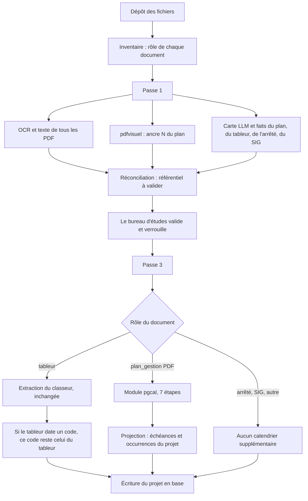
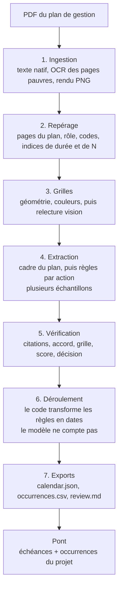

# Plan de gestion dans le pipeline dossier

Un dépôt peut mélanger arrêté, tableur, SIG et plan de gestion. Le pipeline
dossier (`main_pipeline_a_utiliser`) reste le chef d'orchestre : inventaire,
référentiel, validation, écriture du projet. Le module `pgcal`
(`plan_de_gestion_to_calendrier/pgcal`) ne s'exécute que sur un document dont
le rôle est `plan_gestion`, et seulement au moment de construire le calendrier
(passe 3).

Pour un essai, déposer **uniquement le PDF du plan**. Aucun autre fichier n'est
nécessaire : le tableur, le SIG et l'arrêté suivent leur chemin habituel dès
qu'ils sont présents, et restent silencieux s'ils sont absents.

## Insertion dans le pipeline dossier



La passe 1 ne change pas. Elle prépare le référentiel (actions, unités, année N,
questions). Après verrouillage, `annee_N` validée est transmise à pgcal comme
année de départ du calendrier. Si elle est absente, pgcal la lit dans le plan.

## Les sept étapes du plan

Le code appelé est `pgcal.pipeline.run`. Chaque étape écrit ses fichiers dans
`dossier/_pgcal/<nom>_<horodatage>/`. Les appels de modèle sont aussi imprimés
dans les logs du backend, une ligne par appel.



| Étape | Fichier | Ce qui est journalisé |
|---|---|---|
| 1 | `pgcal/s1_ingest.py` | nombre de pages, pages passées à l'OCR |
| 2 | `pgcal/s2_locate.py` | pages retenues, codes candidats |
| 3 | `pgcal/s3_grids.py` | nombre de grilles ; un appel vision par page de grille |
| 4 | `pgcal/s4_extract.py` | durée, année N, nombre d'actions et de règles ; un appel cadre, puis un appel par action |
| 5 | `pgcal/s5_verify.py` | décisions (intégré, à valider, à revoir, déclencheur, à préciser) |
| 6 | `pgcal/s6_expand.py` | nombre d'occurrences datées |
| 7 | `pgcal/s7_export.py` | chemin du dossier de run |

Confiance d'une règle, puis décision :

| Score | Décision | Effet sur le projet |
|---|---|---|
| ≥ 0,80 et aucune alerte | intégré | occurrence `planifie` |
| ≥ 0,55 | à valider | occurrence `a_confirmer` |
| en dessous | à revoir | occurrence `a_confirmer` |
| règle conditionnelle | déclencheur | échéance sans date, hors calendrier |
| récurrence sans fréquence | à préciser | échéance sans date, hors calendrier |

Une fourchette (« tous les 2 à 3 ans ») ou un passage facultatif plafonne la
décision à « à valider ». Une activité continue (« de N à N+30 ») devient une
occurrence par année de la barre, pour qu'elle apparaisse dans le calendrier.

## Projection vers le projet

`plan_de_gestion_to_calendrier/pont.py` transforme la sortie de pgcal dans le
format déjà écrit en base par la passe 3.

- Une règle datée devient une échéance par fenêtre de mois. Mars–avril et
  juillet–août donnent deux échéances, la même récurrence.
- Novembre–février est une fenêtre qui traverse le nouvel an.
- Chaque année déroulée devient une occurrence liée à cette échéance.
- Le code est normalisé (`ES 2` → `ES2` en clé, `ES 2` à l'affichage).
- L'intitulé verrouillé en passe 1, s'il existe, remplace celui lu par pgcal.
- Un code déjà daté par le tableur n'est pas repris depuis le plan.
- Une échéance « aucune date trouvée » créée pour une action du référentiel
  est retirée quand pgcal a produit des dates pour ce code.

Les occurrences partent ensuite dans `ingérer_changeset`, comme celles du
tableur : projet, fiches d'actions du référentiel, échéances, occurrences.

## Ce que les logs montrent

Préfixe `[pgcal]`. Exemples :

```text
[pgcal] document : DOSSIER_plan.pdf
[pgcal] modèles  llm=mistral-large-4-0  vision=mistral-large-4-0  ocr=mistral-ocr-latest  échantillons=3
[pgcal] année N retenue (référentiel verrouillé) : 2025
[pgcal] 1/7 ingestion — DOSSIER_plan.pdf
   [pgcal] → ocr  modèle=mistral-ocr-latest  pages=[4, 5]
   [pgcal] ← ocr  ocr  modèle=mistral-ocr-latest  api  pages=2  11.4s
[pgcal] 2/7 repérage des pages
   [pgcal] → chat  locate  modèle=mistral-large-4-0  n=1
   [pgcal] ← locate  chat  modèle=mistral-large-4-0  api  n=1  ok=1  18.2s  tokens=42000/900
[pgcal] 6/7 déroulement
[pgcal]    135 occurrence(s)
[pgcal] plan.pdf : 120 occurrence(s), 18 échéance(s), 2 sans date — artefacts .../_pgcal/...
```

Un appel rejoué depuis le cache disque est marqué `cache`. Une limite de débit
affiche l'attente et le numéro d'essai. Le journal brut de chaque appel reste
dans `llm_calls.jsonl` du run (modèle, durée, tokens, cache), sans le prompt.

L'OCR du module reprend le modèle OCR du pipeline dossier (`mistral-ocr-latest`),
sauf si `PGCAL_OCR_MODEL` est défini. Le modèle de lecture des règles reste
`mistral-large-4-0` (`PGCAL_LLM_MODEL`, `PGCAL_VISION_MODEL`).

## Fichiers

| Rôle | Chemin |
|---|---|
| Branchement passe 3 | `main_pipeline_a_utiliser/passes/passe3.py` |
| Appel, projection, fusion avec le tableur | `plan_de_gestion_to_calendrier/pont.py` |
| Les 7 étapes | `plan_de_gestion_to_calendrier/pgcal/` |
| Journal des appels | `plan_de_gestion_to_calendrier/pgcal/llm.py` |
| Spécification du prototype | `plan_de_gestion_to_calendrier/README.md` |
