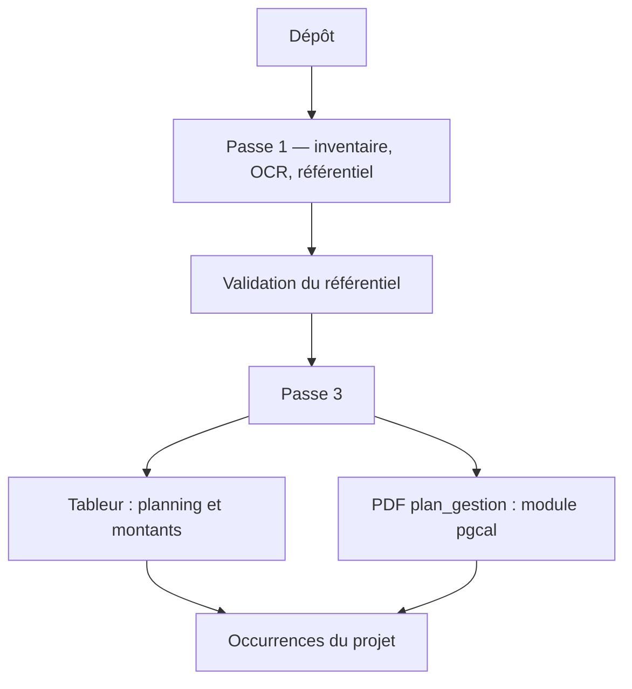

# Pipeline global — du dépôt aux occurrences

> Le calendrier d'un document `plan_gestion` est produit en passe 3 par le module
> pgcal. Schéma et détail : [`DOC_PIPELINE_PLAN_GESTION.md`](DOC_PIPELINE_PLAN_GESTION.md).
> Le tableur, le SIG, l'arrêté et le référentiel de la passe 1 restent décrits ici.
> pdfvisuel fournit toujours l'ancre N en passe 1 ; il ne construit plus le calendrier du plan.

Les étapes 0 à 2 produisent un référentiel à valider. Après verrouillage, la passe 3
produit des échéances, puis les occurrences du projet.

Le module 2 de pdfvisuel (vision API) n'est pas appelé ici. Les grilles viennent du
dessin du PDF (traits, aplats, mots).

## Schéma

Le schéma complet (dossier + les 7 étapes du plan) est dans
[`DOC_PIPELINE_PLAN_GESTION.md`](DOC_PIPELINE_PLAN_GESTION.md).

## Passe 1 — ancre sans état zéro

Juste après l'inventaire, chaque PDF `plan_gestion` est lu par
`pdfvisuel.m1_detection.profil.analyser_pdf`. Le profil est stocké dans
`{cache}/{sha256}.pdfvisuel.json`. Un second dépôt du même fichier ne relance pas la lecture.

Pour chaque grille annuelle, seules les colonnes simples (une année, un rang, pas une
plage « N+6 à N+10 ») donnent `N = annee_debut − n_debut`. Plusieurs grilles du même
document qui trouvent le même N produisent un seul fait :

`Fait("ancre_temporelle", "projet", {"etat_zero": None, "N": 2025, "bloc": …})`,
méthode déterministe, source `p.X grille …`.

La réconciliation :

- s'il existe un N explicite (état zéro absent, ou N différent de état zéro + 1),
  `annee_N` vient de ce vote. `annee_etat_zero` n'est créé que si un état zéro est
  aussi lu, et il ne réécrit pas N ;
- s'il n'y a pas de N explicite, le comportement précédent reste : vote sur l'état
  zéro, puis `annee_N = état zéro + 1` ;
- deux N différents posent la question `ancre_annee_N`, comme le conflit d'état zéro.

Sur le plan Bruges (Rivière, `Plan_de_gestion_de_ddep.pdf`), les colonnes simples
donnent toutes N = 2025. Les plages du type « N+21 à N+25 / 2047 à 2053 » sont
écartées de l'ancre : leur début et leur fin ne désignent pas la même année N.
Confiance haute, sans `annee_etat_zero`.

`_ancre_depuis_lignes` accepte aussi la ligne de rangs au-dessus de la ligne d'années.

## Passe 3 — texte enrichi, uniquement pour les fiches

`extraire_fiches` travaille sur une copie des pages. `assembler` reçoit le markdown
Mistral déjà en cache, insère les grilles à leur place, et le résultat est redécoupé
sur `=== page N ===` puis passé à `markdown_vers_texte`. Les lignes « Lecture : … »
restent : ce ne sont pas des lignes de tableau. Les pages du document inventorié ne
changent pas, donc `faits_tableaux_md` en passe 1 ne relit pas les blocs `[GRILLE]`.

La citation du LLM est cherchée dans ce même texte. Une citation prise sur une ligne
« Lecture » est donc acceptée.

Le prompt de fiche dit que les blocs `[GRILLE]` sont une lecture exacte, et qu'il faut
citer la ligne « Lecture » correspondante.

La ligne de rattachement ne contient que le code (`Rattachement probable : code « RG1 ».`).
`decouper_fiches` ignore en plus toute ligne qui commence par « rattachement probable »,
pour ne pas prendre cette ligne comme titre de fiche.

## Passe 3 — plannings PDF

`extraire_grilles_pdf` lit le profil en cache.

| Marque sur une grille annuelle | Effet |
|---|---|
| Croix ou cellule colorée sur une colonne simple | `Temporalite(forme="rangs", rangs=[…])`, `role_source="planning_pdf"`, confiance 0.9 |
| Colonne à plage (« N+6 à N+10 ») | ignorée, avertissement |
| Bande (« 1 suivi tous les 5 ans ») | non interprétée : la fiche LLM lit la règle |

Le code vient du libellé de ligne s'il contient un code du référentiel, sinon de
`contexte.code_proche`.

Une grille mensuelle rattachée à un code proche devient une `fenetre_pdf`. Plusieurs
plages (mars-avril et juillet-août) restent une liste. La base ne stocke qu'une fenêtre
par échéance (`mois_debut`, `mois_fin`) : la projection émet une échéance par plage,
avec la même récurrence. La fenêtre PDF remplace celle proposée par le LLM.

Priorité du calendrier, pour un même code :

1. `planning_passages` ou `planning_montants` du tableur ;
2. sinon `planning_pdf` ;
3. sinon la fiche.

S'il y a un tableur, la fiche qui décrit une règle n'est qu'un témoin, comme avant.
Sans tableur, une fiche au format `regle` (la bande « tous les 5 ans ») est conservée
en plus des années lues sur les croix.

`rattacher` convertit les rangs avec `annee_N` verrouillé. Sans cette année, le motif
reste `rang_sans_ancre`.

## Recette Bruges, PDF seul

Dépôt du plan, passe 1, verrouillage en acceptant les propositions, passe 3.

| Attendu | D'où ça vient |
|---|---|
| `annee_N` = 2025, confiance haute | colonnes simples des grilles annuelles |
| RG1, RG2, ES1, ES2, FG1, FG2 dans le référentiel | fiches et tableaux de la passe 1 |
| ES1 et ES2 : croix N à N+5, donc 2025 à 2030 | `planning_pdf` |
| puis tous les 5 ans | bande non interprétée, lue par la fiche sur la ligne « Lecture » |
| fenêtre d'ES2 : avril-juin | grille mensuelle, `fenetre_pdf` |
| fenêtre de RG1 : mars-avril et juillet-août | deux échéances |
| aucun rejet `rang_sans_ancre` | N verrouillé avant la passe 3 |

Le Barp, avec son tableur, reste sur `planning_passages`. L'année N y est toujours
état zéro + 1. Les tests `test_pdfvisuel_pont` et `test_carte` couvrent les deux cas.
